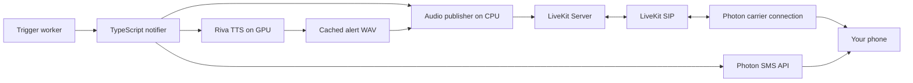

# Calling module and Brev deployment plan

Researched 2026-11-08 against the current checkout and first-party documentation. This is a proposed implementation, not a deployed or live-tested calling integration. Assumes “nVidia brew” means NVIDIA Brev and the spec's single 48 GB L40S.

## Recommended scope

Implement US-8 as a prerecorded announcement: critical alert → roughly 20 seconds of speech → detail text; unanswered call → one retry after two minutes → missed-call text. DTMF acknowledgement is optional. This requires TTS and phone audio transport, with no ASR, conversational agent, or additional LLM. These requirements come from [SPEC.md](../SPEC.md), “Alert delivery via Photon” and US-8.

Self-host LiveKit Server, LiveKit SIP, Redis, a small audio publisher, the notifier and NVIDIA Riva TTS on Brev. Photon remains the phone-number/carrier connection. Self-hosting the SIP bridge does not replace access to the telephone network; see [LiveKit's SIP architecture](https://docs.livekit.io/transport/self-hosting/sip-server/) and [outbound calling](https://docs.livekit.io/telephony/making-calls/outbound-calls/).



## Correct the Photon setup in the spec

The default REST sender uses Photon **v2/Beta**, identifiable by `api.photon.codes`, `pho_prj_` and `pho_sk_`; Spectrum is a separate legacy sender. [Photon's version index](https://photon.codes/docs/llms.txt) documents these distinctions.

For v2, assign the SMS number to a SIP Voice profile and enable outbound calls. Generate that profile's SIP username/password; these are separate from the REST key and Spectrum credentials. Configure a LiveKit outbound trunk with the profile's connection address (production `sip.photon.codes:5061`), TLS, the Photon number as caller ID, and SRTP. An eligible SMS number supports voice; shared iMessage assignments do not. Outbound-only delivery needs no inbound trunk or inbound dispatch rule. [Photon v2 LiveKit cookbook](https://photon.codes/docs/beta/cookbooks/voice/livekit).

The spec's `sip.spectrum.photon.codes` and project-secret instructions therefore need revision for this integration. Keep `ALERT_PHONE` as the recipient, distinct from the originating Photon number.

SMS needs a code change too. `notifier/src/photon.ts` hardcodes `platform: "imessage"` for user creation, user/space lookup and space creation. Add a platform setting, apply it consistently, select the SMS agent/sender identity, and include the platform in route/idempotency namespaces. Update doctor diagnostics accordingly. Photon v2 documents the same Users/Spaces/Messages pattern with `platform: "sms"`; its launch documentation also notes SMS activation/registration in the dashboard. [Photon v2 API example](https://photon.codes/blog/introducing-photon-2.0). A number change alone does not change the current sender's selected platform. Calls and SMS require E.164 recipients; retain email handles only for iMessage text delivery.

## Repository changes

These are proposed changes; the referenced files describe the current implementation.

| Location | Change |
| --- | --- |
| `notifier/src/config.ts` | Add voice provider selection, LiveKit URL/key/secret/trunk ID, Riva endpoint/voice, audio cache and call timeouts. Keep text and voice provider settings independent. |
| `notifier/src/photon.ts`, `doctor.ts` | Add SMS platform and sender selection; validate the selected platform's actual line and recipient. |
| New `notifier/src/voice.ts` | A voice interface for starting/reconciling/cancelling an attempt and collecting its outcome. Implement LiveKit control here; keep audio publication in a small Node or Python RTC worker. |
| New `notifier/src/tts.ts` | Build a short script from stored title/summary, synthesize through Riva HTTP, validate/cache the WAV by alert and script hash. Bound runtime and script length. |
| `notifier/src/deliveries.ts` | Replace the unconditional call-to-text fallback with a durable call workflow. Branch on `channel`, not severity. |
| `notifier/src/store.ts` | Persist call attempts, room/participant identities, provider identifiers, outcome, playback completion, next retry time, text state and callback events independently. |
| `notifier/src/server.ts` | Validate call destinations; preserve accept-before-work behavior and alert-ID idempotency. |
| `backend/finance_hub/api.py` | Add an authenticated notifier-readable alert-state endpoint if needed for retry cancellation; existing dashboard list endpoints require app auth. |
| `backend/finance_hub/triggers.py` | Keep severity and initial call authorization here; implement the full-spec daily limit if required. Current code implements a five-minute call reservation guard, not three calls per day. |

The current integration already persists an alert before responding 202, honors idempotency by alert ID, and PATCHes backend delivery state. Preserve that contract. Today `deliveries.ts` always sends text and reports `text_fallback` for `channel=call`. `store.ts` only models text outcomes, and `callbackDone` is one boolean for the entire delivery. Multiple call-state callbacks need an ordered durable outbox or equivalent event tracking.

Suggested workflow:

1. Persist the job; return 202 within the backend's 15-second HTTP timeout.
2. Render the WAV from the evidence-grounded summary using the already-warm TTS service.
3. Join a dedicated room and publish an audio track before dialing. Create a SIP participant through the outbound trunk; wait for answer before feeding the announcement. Drain playback before hanging up. LiveKit supplies the call connection; the application supplies audio. [LiveKit outbound API](https://docs.livekit.io/telephony/making-calls/outbound-calls/).
4. Record call outcomes independently from SMS. After completed playback, send one detail text. Report `calling` when dialing, and `sent` after successful announcement/text dispatch; reserve `delivered` for evidence that matches the product's chosen delivery meaning. An answered SIP call is not proof a human heard it.
5. For no answer/busy, persist a retry due two minutes later. Send the initial detail text without finalizing the pending voice retry; after the second missed attempt, send a distinct missed-call text and finalize `text_fallback`. For unrecoverable voice/TTS failure, use immediate text fallback.
6. Before retrying, read backend ack/snooze state; suppress or postpone the retry accordingly. Persist acknowledgement before callback. Do not retry authentication/configuration failures as missed calls.

Use separate SMS keys for detail and missed-call messages. Keep network-send retries separate from the maximum of two physical dial attempts. Record/reconcile uncertain in-flight calls on restart before dialing again: an alert-ID key in the local store cannot guarantee exactly-once external calls after a crash.

Do not put the two-minute wait in the existing single Promise queue. Call lifetimes and callback backoff would block other texts/calls and threaten the 60-second ring target. Use persisted due jobs and separate workers for dialing, text and callbacks. The backend treats `delivered` and `text_fallback` as terminal, so avoid reporting either while a call retry is pending. [Current notifier](../notifier/src/deliveries.ts), [backend callback rules](../backend/finance_hub/api.py), [handoff contract](../README.md).

## Brev deployment

Run CPU services as supervised containers: notifier, publisher, LiveKit, SIP, Redis, backend/worker and frontend. Put Riva and any local language/embedding inference in GPU containers. Persist the database, notifier journal, WAVs and model caches. Use explicit model memory budgets, health checks, restart policies and pinned image versions. This is the proposed deployment layout, rather than an existing compose configuration.

**Check public UDP connectivity before choosing the instance.** LiveKit SIP's documented default RTP range is UDP 10000–20000. LiveKit also needs its configured WebRTC transport ports; its standard range is UDP 50000–60000, with a UDP mux option at 7882. SIP defaults are 5060 TCP/UDP and 5061 for configured TLS. Expose only the directions/transports actually configured, with a correct advertised public address; internal HTTP service ports can stay private. [SIP deployment](https://docs.livekit.io/transport/self-hosting/sip-server/), [port reference](https://docs.livekit.io/transport/self-hosting/ports-firewall/).

Brev SSH port forwarding supports TCP, not UDP. Its web tunnels can require browser authentication. Neither mechanism alone establishes the required SIP/RTP deployment. Confirm direct host/provider firewall access and whether you are configuring the development container or host VM. If the selected GPU instance cannot expose media correctly, run LiveKit/SIP on a small public CPU VM and retain Riva on Brev, or use LiveKit Cloud for transport. [Brev connectivity](https://docs.nvidia.com/brev/cli/connectivity), [Brev environment](https://docs.nvidia.com/brev/latest/cli/getting-started).

### GPU budget

Do not treat the spec's roughly 14 GB remaining beside Nano/Embed as free TTS capacity. NVIDIA's current Magpie Multilingual TTS NIM lists about **12.58 GiB** GPU memory for its default `batch_size=8` profile and requires at least a 16 GB GPU. Adding that to the spec's approximately 32 GB Nano and 2 GB embedding estimates leaves very little headroom on 48 GB for KV cache and runtime. Those spec estimates and the current NIM profile are different units/measurements, so measure the actual combined workload. [NVIDIA TTS support matrix](https://docs.nvidia.com/nim/speech/latest/reference/support-matrix/tts.html).

For one L40S, first bring up Riva and calling with language models hosted. Then co-locate a more aggressively quantized Nano and embeddings only after measuring peak VRAM and latency under load, with bounded context/concurrency. A second GPU or a larger GPU avoids this packing constraint. Using a lighter CPU TTS engine is another possible design change, but would depart from the spec's Riva choice. No hardware-fit claim is validated here.

Riva's current HTTP API supports readiness checks, voice discovery and offline WAV synthesis. The notifier can call it directly; a Python TTS proxy is unnecessary. Keep it warm: the first initialization can take up to 30 minutes. [NVIDIA deployment tutorial](https://docs.nvidia.com/nim/speech/latest/get-started/tutorials/tts.html).

Illustrative local request after Riva is deployed and ready (not run during this research):

```sh
curl --fail-with-body http://127.0.0.1:9000/v1/audio/synthesize \
  -F language=en-US \
  -F voice=Magpie-Multilingual.EN-US.Aria \
  -F text='Critical Finance Hub alert. A watched event needs your attention. Details sent by text.' \
  --output alert.wav
```

## Implementation order and acceptance checks

1. Configure the actual Photon v2 Voice profile and prove one manual call with audible local WAV playback. A ringing silent room is insufficient.
2. Wire Riva rendering and the notifier's call branch. Inject a critical event and measure detection-to-ring under 60 seconds with normal app/model load.
3. Add persisted missed-call retry, distinct detail/fallback texts, restart reconciliation, cancellation and callbacks.
4. Verify SMS delivery from the newly selected SMS line and update SPEC.md's old iMessage/Spectrum assumptions.
5. Test duplicate `/notify` requests, process restart while dialing/waiting, busy/no-answer, TTS outage, callback failure/reordering, dashboard acknowledgement/snooze and throttled Critical alerts with `channel=text`. Confirm they never dial.

Clarify whether the spec's three-calls-per-day cap counts physical retry attempts or alert escalations; for a literal cap on calls, reserve capacity for each dial transactionally. Current backend reservations cover initial alert dispatch only.

No calls were placed, credentials inspected, packages installed or services deployed for this note. Existing working-tree edits were left intact.
